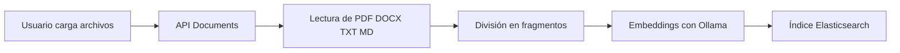
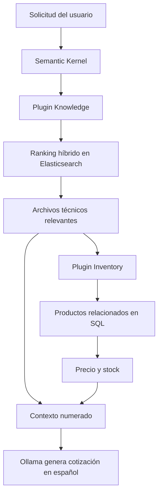

# Purchasing Agent

Aplicación para cargar fichas técnicas, mantener inventario de productos y generar cotizaciones fundamentadas en documentación oficial, precios y stock real.

El sistema combina:

- Angular para la interfaz web.
- ASP.NET Core y Clean Architecture para la API.
- SQL Server para productos, precios y existencias.
- Elasticsearch para búsqueda documental BM25, vectorial e híbrida.
- Ollama para embeddings y generación local de respuestas.
- Semantic Kernel para orquestar la consulta de conocimiento e inventario.

## Funcionalidades

- Carga múltiple de documentos PDF, DOCX, TXT y Markdown.
- Extracción, división e indexación automática del contenido.
- Consulta de documentos cargados y cantidad de fragmentos indexados.
- Búsqueda BM25, vectorial KNN o híbrida.
- Preguntas en lenguaje natural sobre el conocimiento cargado.
- Administración de productos, precios y stock.
- Cotizaciones en español basadas en requisitos técnicos y disponibilidad.
- Validación de stock antes de recomendar un producto.
- Cálculo de precio unitario y subtotal por alternativa.
- Referencias a los fragmentos documentales utilizados.

## Arquitectura

```text
Frontend Angular
      |
      v
ASP.NET Core Web API
      |
      +--> Application: casos de uso, DTO y puertos
      |
      +--> Domain: Product, Stock y modelos RAG
      |
      +--> Infrastructure
              +--> SQL Server / Entity Framework Core
              +--> Elasticsearch
              +--> Ollama
              +--> Semantic Kernel
```

El backend está organizado en:

| Proyecto | Responsabilidad |
| --- | --- |
| `CleanArchitecture.Domain` | Entidades, reglas de dominio e interfaces de repositorio |
| `CleanArchitecture.Application` | Servicios de aplicación, DTO y contratos RAG |
| `CleanArchitecture.Infrastructure` | SQL Server, Elasticsearch, lectura documental, Ollama y Semantic Kernel |
| `CleanArchitecture.WebApi` | Controladores, configuración y composición de dependencias |
| `CleanArchitecture.UnitTests` | Pruebas de dominio, aplicación, repositorios y plugins |

## Flujo de carga documental



1. El usuario carga uno o varios documentos desde **Biblioteca**.
2. La API guarda temporalmente los archivos.
3. El lector extrae el texto según el formato.
4. El texto se divide en fragmentos de 1000 caracteres por defecto.
5. Ollama genera un embedding para cada fragmento con `nomic-embed-text`.
6. Elasticsearch crea automáticamente el índice `doc-chunks` si no existe.
7. Los fragmentos quedan disponibles para búsqueda y cotizaciones.
8. Los archivos temporales se eliminan al terminar la carga.

No es necesario crear manualmente el índice de Elasticsearch.

## Flujo de cotización

Ejemplo de solicitud:

```text
Cotiza 6 laptops con 16 GB de RAM y 1 TB de almacenamiento.
```



El flujo es determinista:

1. `KnowledgePlugin` busca los fragmentos técnicos más relevantes.
2. La búsqueda híbrida combina BM25 y KNN mediante Reciprocal Rank Fusion.
3. Se toman los nombres únicos de las fichas que aparecen en el ranking.
4. `InventoryPlugin` consulta SQL únicamente para productos asociados a esas fichas.
5. Semantic Kernel combina especificaciones, precio y stock como fuentes numeradas.
6. Ollama valida los requisitos y genera una tabla comparativa en español.
7. Un producto no se presenta como disponible si su stock es menor que la cantidad solicitada.
8. El subtotal se calcula como `cantidad solicitada × precio unitario`.

El inventario completo no se envía al modelo. Solo se recuperan los productos vinculados con documentos clasificados por Elasticsearch, lo que reduce tokens y resultados irrelevantes.

## Relación entre documentos e inventario

La vinculación actual usa el nombre de la ficha técnica guardado en `Products.Description`:

```text
Ficha oficial: lenovo-thinkpad-t14-gen5-intel-spec.pdf
```

El valor debe coincidir con el nombre del archivo indexado. Los prefijos agregados durante una carga múltiple, como `0_`, se eliminan antes de consultar SQL.

Para productos creados manualmente que deban participar en cotizaciones, utiliza esta convención en la descripción:

```text
Ficha oficial: nombre-exacto-del-archivo.pdf
```

## Modelo de datos

### Products

| Campo | Tipo | Descripción |
| --- | --- | --- |
| `Id` | `INT` | Identificador del producto |
| `Name` | `NVARCHAR(200)` | Nombre comercial o modelo |
| `Description` | `NVARCHAR(1000)` | Descripción y referencia a la ficha oficial |
| `Price` | `DECIMAL(18,2)` | Precio unitario |

### Stocks

| Campo | Tipo | Descripción |
| --- | --- | --- |
| `ProductId` | `INT` | PK y FK hacia `Products.Id` |
| `Quantity` | `INT` | Unidades disponibles |

La relación es uno a uno. Al eliminar un producto, su stock se elimina en cascada.

## Requisitos

- [.NET SDK 10](https://dotnet.microsoft.com/download)
- [Node.js 22 LTS](https://nodejs.org/)
- npm 10 o compatible
- SQL Server
- SQL Server Management Studio o Azure Data Studio
- [Docker Desktop](https://docs.docker.com/desktop/setup/install/windows-install/)
- [Ollama](https://ollama.com/download/windows)

## Instalación

### 1. Clonar el repositorio

```powershell
git clone <repository-url>
Set-Location Purchasing-Agent
```

### 2. Preparar SQL Server

Ejecuta `Database/PurchasingDb.sql` en SQL Server Management Studio o Azure Data Studio.

El script:

- Crea la base `PurchasingDb` si no existe.
- Crea `Products` y `Stocks`.
- Configura la FK y las restricciones de precio y cantidad.
- Migra una tabla anterior llamada `Stock` a `Stocks` si es necesario.
- Inserta datos de prueba de Lenovo, HP, Dell y Samsung.
- Puede ejecutarse varias veces sin duplicar productos.

Configura la conexión antes de iniciar la API:

```powershell
$env:ConnectionStrings__DefaultConnection = "Server=localhost;Database=PurchasingDb;Trusted_Connection=True;TrustServerCertificate=True;"
```

También puedes modificar `Backend/CleanArchitecture/CleanArchitecture.WebApi/appsettings.json`.

Si la cadena queda vacía, la API utiliza una base InMemory. Este modo se usa en CI, pero los datos no persisten.

### 3. Iniciar Elasticsearch

Primera ejecución:

```powershell
docker run --name rag-elasticsearch -d -p 9200:9200 -e "discovery.type=single-node" -e "xpack.security.enabled=false" -e "ES_JAVA_OPTS=-Xms1g -Xmx1g" docker.elastic.co/elasticsearch/elasticsearch:9.4.2
```

Ejecuciones posteriores:

```powershell
docker start rag-elasticsearch
```

Verificación:

```powershell
Invoke-RestMethod http://localhost:9200
```

### 4. Preparar Ollama

Descarga los modelos:

```powershell
ollama pull nomic-embed-text:latest
ollama pull qwen2.5:1.5b-instruct
```

Si Ollama no se inició como servicio o aplicación de escritorio:

```powershell
ollama serve
```

Verificación:

```powershell
Invoke-RestMethod http://localhost:11434/api/tags
```

El conector oficial de Semantic Kernel para Ollama utilizado por el proyecto es una dependencia prerelease.

### 5. Iniciar el backend

```powershell
dotnet restore Backend/CleanArchitecture/CleanArchitecture.sln
dotnet run --project Backend/CleanArchitecture/CleanArchitecture.WebApi --launch-profile http
```

Servicios disponibles:

- API: `http://localhost:5117`
- Swagger: `http://localhost:5117/swagger`

### 6. Iniciar el frontend

En otra terminal:

```powershell
Set-Location Frontend/purchasing
npm i
ng serve
```

Abre `http://localhost:4200`.

El frontend usa `http://localhost:5117/api`, configurado en `Frontend/purchasing/src/environments/environment.ts`.

## Uso de la aplicación

### Biblioteca

Ruta: `/`

- Selecciona uno o varios archivos.
- Formatos permitidos: PDF, DOCX, TXT y MD.
- Pulsa **Cargar archivos**.
- Espera la confirmación de documentos procesados.
- Revisa los archivos indexados y su cantidad de fragmentos.

Para el catálogo de prueba, carga las fichas de la carpeta `official-specifications` utilizada para generar `Database/PurchasingDb.sql`. En el entorno de demostración puede encontrarse en una ruta como:

```text
C:\Users\<usuario>\Documents\Purchasing-Agent\sample-documents\purchasing-demo\official-specifications
```

### Preguntar al conocimiento

Ruta: `/search`

- Escribe una pregunta o solicitud de cotización.
- Incluye cantidad y requisitos técnicos concretos.
- El sistema mostrará la respuesta y las fuentes utilizadas.

Ejemplos:

```text
Cotiza 6 laptops con 16 GB de RAM y 1 TB de almacenamiento.
```

```text
¿Qué equipos con procesador AMD tienen al menos 4 unidades disponibles?
```

```text
Compara las opciones disponibles para 3 laptops empresariales y recomienda la más económica.
```

### Stock

Ruta: `/inventory`

- Consulta productos, precios y existencias.
- Busca productos por nombre.
- Registra nuevos productos.
- Los valores menores a 5 unidades se muestran como stock bajo.

## Configuración

La sección `Rag` se encuentra en `appsettings.json`:

```json
{
  "Rag": {
    "ElasticsearchUrl": "http://localhost:9200",
    "OllamaUrl": "http://localhost:11434",
    "EmbeddingModel": "nomic-embed-text:latest",
    "ChatModel": "qwen2.5:1.5b-instruct",
    "IndexName": "doc-chunks"
  }
}
```

Variables de entorno admitidas:

| Variable | Uso |
| --- | --- |
| `ConnectionStrings__DefaultConnection` | Conexión de SQL Server |
| `ES_URL` | URL de Elasticsearch |
| `OLLAMA_URL` | URL de Ollama |
| `DOCRAG_EMBED_MODEL` | Modelo de embeddings |
| `DOCRAG_LLM_MODEL` | Modelo de chat |

Reinicia la API después de cambiar la configuración.

## API

### Documentos

| Método | Endpoint | Descripción |
| --- | --- | --- |
| `POST` | `/api/documents/ingest-file` | Carga un documento |
| `POST` | `/api/documents/ingest-files` | Carga varios documentos |
| `POST` | `/api/documents/search` | Busca fragmentos documentales |
| `POST` | `/api/documents/ask` | Genera una respuesta o cotización |
| `GET` | `/api/documents` | Lista documentos indexados |
| `GET` | `/api/documents/chunks` | Lista fragmentos indexados |
| `GET` | `/api/documents/{fileName}/info` | Consulta información de un documento |

Ejemplo de pregunta:

```http
POST /api/documents/ask
Content-Type: application/json
```

```json
{
  "question": "Cotiza 6 laptops con 16 GB de RAM y 1 TB de almacenamiento",
  "mode": "Hybrid",
  "top": 8
}
```

Modos de búsqueda:

| Modo | Comportamiento |
| --- | --- |
| `Hybrid` | Combina BM25 y KNN; recomendado |
| `Bm25` | Coincidencia léxica de texto |
| `Knn` | Similitud semántica por embeddings |

### Productos

| Método | Endpoint | Descripción |
| --- | --- | --- |
| `GET` | `/api/products` | Lista productos y stock |
| `GET` | `/api/products/{id}` | Obtiene un producto |
| `POST` | `/api/products` | Crea un producto y su stock |
| `PUT` | `/api/products/{id}` | Actualiza producto y stock |

Ejemplo de creación:

```http
POST /api/products
Content-Type: application/json
```

```json
{
  "name": "Lenovo ThinkPad T14 Gen 5 Intel",
  "description": "Ficha oficial: lenovo-thinkpad-t14-gen5-intel-spec.pdf",
  "price": 1249.99,
  "stock": 8
}
```

## Pruebas y compilación

Backend:

```powershell
dotnet restore Backend/CleanArchitecture/CleanArchitecture.sln
dotnet build Backend/CleanArchitecture/CleanArchitecture.sln --configuration Release --no-restore
dotnet test Backend/CleanArchitecture/CleanArchitecture.sln --configuration Release --no-build --no-restore
```

Frontend:

```powershell
Set-Location Frontend/purchasing
npm ci
npm run test:ci
npm run build
```

SSR:

```powershell
npm run build
npm run serve:ssr:purchasing
```

## Integración continua

El workflow `.github/workflows/ci.yml` se ejecuta para `push` y `pull_request` sobre `main` y `dev`.

El job backend:

- Restaura y compila la solución en Release.
- Ejecuta las pruebas y publica el archivo TRX.
- Inicia la API con base InMemory.
- Verifica `GET /api/products`.

El job frontend:

- Instala dependencias con `npm ci`.
- Ejecuta las pruebas Angular.
- Genera el build de producción.
- Inicia el servidor SSR y verifica la página principal.


